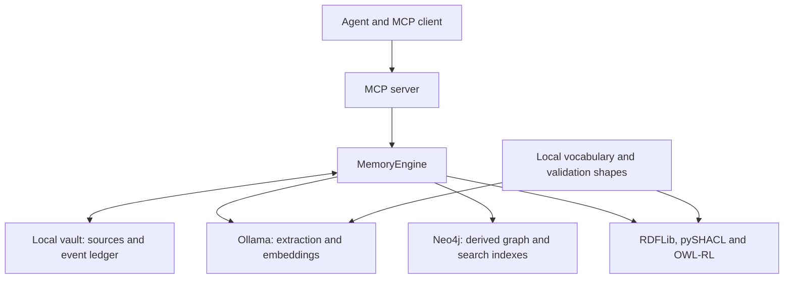

# Architecture and components

[Documentation index](README.md)

The system is a persistent memory with sources and history. Search indexes and semantic
views are built from that memory. An agent calls the MCP tools and uses the returned data
to formulate answers.

Saving, retrieving and deriving information are separate operations. Storing a memory
does not train a model, and ordinary retrieval does not automatically execute OWL reasoning.

## Runtime components

| Component | Responsibility |
| --- | --- |
| Agent and client | Decide when to save, what to search for and whether to request deductions. Connecting an MCP server does not automatically record the conversation. |
| MCP server, in the `mcp` container | Exposes tools and source resources, validates tool arguments and enforces HTTP access controls. |
| `MemoryEngine`, in the same container | Coordinates sources, extraction, validation, identities, temporal state, retrieval and projections. |
| Local vault | Stores immutable Markdown originals, the event ledger and generated Markdown views. |
| Ollama, in its own container | Runs local models through `/api/chat` and `/api/embed`. |
| Qwen, configured by default as `qwen2.5:1.5b` | Proposes structured extractions from free text. |
| EmbeddingGemma, configured as `embeddinggemma` with 768 dimensions | Produces comparable vectors for claim statements and search questions. |
| Neo4j, in its own container | Stores the graph projection, full-text index and vector index. |
| RDF/RDFS/OWL vocabulary | Defines concepts, canonical relation names, class hierarchies and supported axioms. |
| RDFLib, pySHACL and OWL-RL, in the MCP container | Build RDF snapshots, validate graph constraints and execute requested formal deductions. |

Model names and dimensions are configurable. The names above describe the repository's
default configuration, rather than a requirement to use those models forever.



## What MemoryEngine actually is

`MemoryEngine` is a Python class written for this project, implemented in
[`engine.py`](../src/second_brain/engine.py). It is instantiated in the Python process
running the MCP server. It is neither an AI model nor another Docker service.

For example, the MCP `remember` wrapper calls `MemoryEngine.remember()`. That method saves
the source and invokes the extraction flow. Other methods implement retrieval, changes,
status reporting, exports and reasoning. The engine delegates model execution to Ollama
and graph operations to Neo4j.

```text
Agent
  → MCP tool, such as remember
    → MemoryEngine method
      → files, validators, Ollama and Neo4j
    ← structured result
  ← tool response
```

Blocking engine calls are dispatched through worker threads by the MCP wrappers. This
keeps a slow model or database call from blocking the server's asynchronous event loop.
These request threads are not a persistent background recovery worker.

## Docker services and startup

The normal deployment has three long-running services: `mcp`, `ollama` and `neo4j`.
The one-shot `models-init` service checks that the configured models are installed and
downloads missing ones before normal startup completes. It does not run for each memory.

The vault is bind-mounted from the host into `/data/vault`. Neo4j data and logs use Docker
volumes; Ollama model files use their own volume. Application data therefore lives outside
the disposable writable layer of the MCP container.

The Compose network lets the MCP process reach Ollama at `http://ollama:11434` and Neo4j
over Bolt at `bolt://neo4j:7687`. Published ports bind to the host's loopback interface.
All memory processing services can run locally without paid model APIs. The agent client
itself may use a local or remote model, depending on how that client is configured.

## The MCP boundary

The server supports Streamable HTTP at `/mcp` and stdio. HTTP uses owner-managed bearer
credentials with read or read/write permissions. It also applies request-size, rate and
concurrency limits and checks allowed hosts and origins. Stdio inherits the owner's OS
access to the process and its files.

MCP supplies tools and instructions; it does not guarantee that a client will expose every
instruction to its model or that a model will follow a particular sequence of tools.
See [reasoning decisions](reasoning.md#who-decides-to-request-deductions) and
[recovery limitations](reliability-and-recovery.md).

## Authoritative data and derived views

Immutable source snapshots and the append-only event ledger are authoritative. Neo4j,
entity Markdown profiles and RDF representations are derived from them. RDF snapshots
are built on demand; there is no additional persistent RDF database service.

Storing more memories grows the files, graph and indexes. It does not modify the weights
of Qwen or EmbeddingGemma. See the [storage model](storage-and-data-model.md),
[ingestion flow](ingestion.md) and [retrieval flow](retrieval.md).
