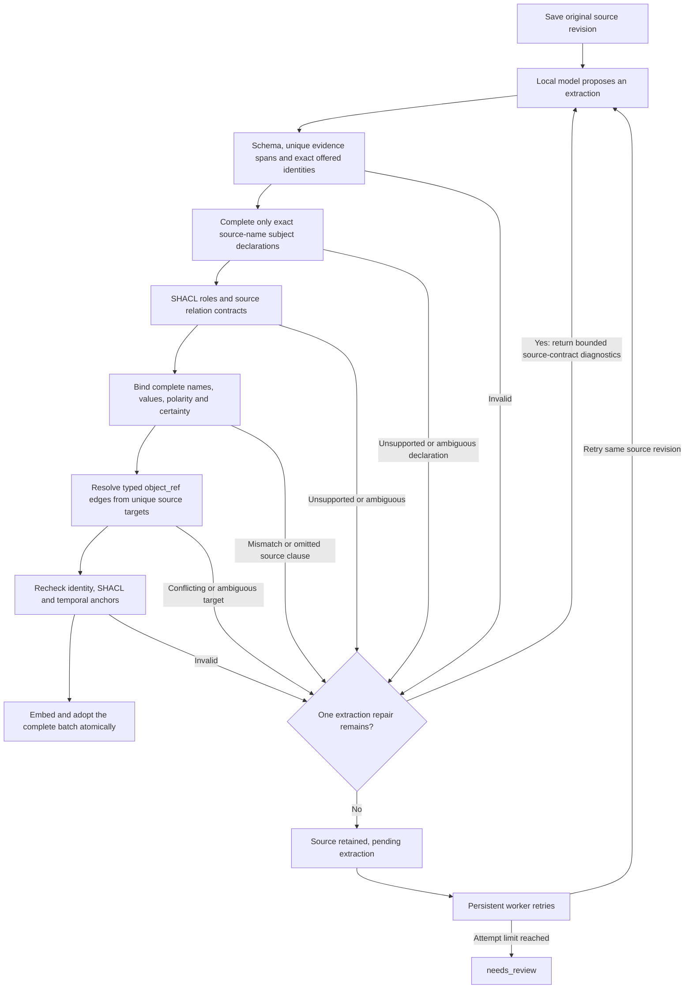

# Source support and extraction quality

[Documentation index](README.md)

Automatic extraction separates the local model's proposal from deterministic
acceptance. A correct quote can still accompany the wrong subject, relation,
polarity or object. These checks establish support by the source within a defined
language subset; they do not establish real-world truth or general semantic accuracy.
**No AI reviewer is invoked or trusted to authorize adoption.**

## Acceptance flow

There are at most two extraction requests per foreground/worker attempt. HTTP
failures use the worker retry policy. A failed batch contributes no assertions or
embeddings. The existing SQLite queue survives restarts and eventually exposes
`needs_review`; a chat agent does not have to notice or schedule recovery. The
source-revision lock allows time for two extraction calls and embedding generation.

## Deterministic contracts

[`quality.py`](../src/second_brain/quality.py) recognizes source clauses independently
of candidate output and binds each accepted claim to exactly one source witness.
A witness records the complete subject and target spans, the relation, affirmation
or denial, certainty, and source offsets. The quote must cover the supporting
relation in that same clause. An object-only quote cannot establish a triple.

| Check | Behavior |
| --- | --- |
| Exact evidence | Correct explicit offsets can disambiguate repeated quotes. Otherwise only one source occurrence, including overlapping matches, is accepted. Limited typography normalization can locate a length-preserving span; stored evidence is copied from the original. |
| Complete identity | Every used new name occurs in the source; upper-case/digit suffixes and lower-case date/name connectors are checked. Contract binding also requires the complete source subject/target, allowing leading grammatical determiners and the explicit Italian activity descriptor. No fuzzy identity merge is performed. |
| Relation and direction | A visit during an event is `planned_visit`, not `destination` or `preference`. Participation and its inverse have different subject/object roles. A quote with the right words does not authorize a different predicate. |
| Exact target/value | Identifying qualifiers, container details, numbers, units and recurrence must survive. `drawer of the hall` cannot become `hall`. Arbitrary translations and summaries are rejected, rather than semantically guessed. |
| Polarity | The assertion/denial of the bound relation determines polarity. An affirmative pending status is positive; an explicitly denied participation is negative. Negation in another sentence does not flip this claim. |
| Certainty | Recognized tentative clauses require `proposed`; affirmed clauses require `explicit`. Names such as `May Bell` do not count as modal verbs. Raw extraction cannot introduce `inferred` claims. |
| Structural coverage | Every recognized source witness must be represented. Substantive clauses without a supported contract keep the source pending; they are not silently omitted. Only allowlisted greetings and explicit instruction clauses are excluded. This is not a proof of completeness for arbitrary language. |

Source statements replace the candidate's readable `statement` with the exact
supporting source clause; this mechanical change is logged. The original quote and
source revision remain unchanged. An incorrect value, predicate, polarity, certainty
or supplied target is not silently rewritten into a different claim.

### Recovering representational false rejections

The `source-contracts-v4` gate adds narrowly defined equivalences:

- Prices accept an isolated two-place decimal comma or decimal point. The complete
  remaining value must match: currency, sign, units and recurrence cannot change.
  Grouping separators are not interpreted or removed.
- Deadline literals accept equivalent explicitly zoned instants, comparing UTC.
  Only a full timestamp literal is equivalent; a date alone, omitted timezone,
  different instant or added qualification is rejected. The source wording becomes
  the stored value. A deadline is not converted into claim validity.
- A participation value may contain the full verb phrase and event name. Its
  affirmation/denial and complete target must agree with the source witness before
  the engine normalizes it to the target and supplies the typed edge.
- An omitted subject declaration can be completed only if the missing reference is
  itself the complete source name and the source uniquely supports the same
  predicate, target, polarity, certainty and covering quote. Short or opaque refs
  are never guessed. An existing declaration is never renamed or retyped. The
  declared domain supplies a minimum type; unique compatible offered identities
  retain their exact ID/name/kind. Homonyms remain errors.
- Repeated declarations with the same ref and every field identical are coalesced,
  with an audit entry. Different names, kinds or existing IDs for one ref remain an
  error; distinct refs are never merged. Schema size limits apply before coalescing.

For omitted subject declarations, offered identity lookup also applies the same
bounded grammatical determiner/activity-descriptor equivalence used by source
contracts. It preserves the offered exact name/ID/kind and rejects ambiguous
homonyms, so an article such as `The` does not silently create a duplicate entity.

Schema limits, grounding, offered identities, SHACL and temporal validation still
apply after these operations. Normalizations are logged in provenance and no
omitted claims are synthesized to pass the complete-batch check.

The single model repair now receives machine-readable diagnostics generated by
the source parser: complete subject/target, canonical predicate, minimum role
types, polarity, certainty and exact quote offsets. They contain at most 20
contracts and 12,000 characters of contract JSON, with explicit completeness
metadata. Unsupported substantive source syntax produces no partial hint set;
greetings request an empty extraction. These diagnostics are source data, not
permissions to follow embedded instructions, and do not authorize adoption. The
repaired model output must pass every check again. The v4 benchmark retained its
first-generation prompt, schema, vocabulary and two-request budget. The v5 change
below subsequently adds clause-specific representation choices and repair diagnostics,
without changing the general system prompt, extraction schema or vocabulary guide.
Repair starts from the original system/source messages plus bounded diagnostics; the
rejected assistant JSON is not echoed back for the model to copy. There is still only
one repair request, and its complete output passes all acceptance checks again.

### Literal and entity-valued preferences

`source-contracts-v5` keeps two distinct vocabulary properties:

- `preference` stores a literal preference description and forbids `object_ref`.
- `prefers` links an agent to a complete source-named entity and requires a typed
  target. `preferred_by` retains the inverse direction with its declared roles.

An explicit `preferisce`, `preferiscono`, `prefer` or `prefers` clause supplies one
source witness that can support either representation. The binder checks the same
complete owner/target spans, covering quote, polarity, certainty, identity, role
types and dates in both forms. Missing declarations/targets use the existing exact
source-name rules; no fuzzy match or AI reviewer is introduced. The chosen property
is preserved, and provenance records v5. There is no global alias or OWL equivalence
between a literal property and an object property.

Wanting/desiring something does not license `prefers`; a tentative visit does not
become a preference. A wrong value, truncated name, reversed direction, incompatible
type or changed negation remains invalid. The same source witness cannot produce
both representations, including a direct/inverse pair. Separate source clauses can
choose different representations. A rejected mixed note still contributes no partial
claims. Regression tests cover these boundaries and concurrent retry of one saved
revision in [`test_preference_contracts.py`](../tests/test_preference_contracts.py).

### Language coverage and extension

The current Italian/English rules cover common forms for destinations, participation,
employment/project work, locations, visits during events, preferences, deadlines,
status, email, websites, prices and payment status. Explicit controlled-language
triples such as `Notebook North owned_by Nora Bell.` support **any registered
predicate key**, including vocabulary extensions, with the declared domain/range.
Adding a vocabulary label alone does not teach the parser arbitrary paraphrases.
New natural-language contracts require code and positive/negative regression tests.

This is intentionally conservative. Relative clauses, pronouns, implicit subjects,
complex coordination, unfamiliar tense or unsupported languages can remain pending
although a human would understand them. Fresh real notes and held-out tests are
necessary to expand coverage safely. A small synthetic regression corpus cannot
establish universal accuracy. `needs_review` requires inspecting the source and, if
appropriate, submitting an explicitly reviewed structured extraction.

### Entity-valued relations and object_ref

For automatic extraction, every registered object property requires an actual
`object_ref`, with a compatible target class. The engine can complete an omitted
reference only when a contract unambiguously supplies the complete target:

1. Reuse one matching candidate entity; multiple candidates are ambiguous.
2. Otherwise create a draft entity from the exact source target and the property's
   declared range, not from invented external knowledge.
3. Reuse an exact, same-scope offered identity when unique. Preserve an offered
   compatible subclass, such as `city` for a `place` target. Homonyms require review.
4. Recheck source grounding, exact offered ID/name/type/scope, extraction limits and
   SHACL after binding. A supplied incompatible type or contradictory `object_ref`
   is rejected, never fixed by selecting another node.

Values on object properties identify the target. A recognized participation status
can be normalized to the named target only when its polarity agrees with the source
relation. Literal properties require no `object_ref`. No cross-note identity is
inferred merely because two new names look similar.

## Temporal support and provenance

Supplied instants must match explicit zoned ISO or Italian/English day-month
timestamps in the evidence or local clauses for that subject. A prefixed explicit
validity interval must preserve both bounds. Instants are compared in UTC. Invalid
dates, invented dates or borrowed dates from other subjects are rejected. A null
start uses `observed_at`; the existing bitemporal ledger and corrections remain
unchanged. These bounded rules do not implement general temporal language parsing.

Accepted provenance includes `extractor_version`, `quality_checks.version`
(`source-contracts-v5` for current automatic extractions), normalized draft digest,
mechanical normalization details,
verification method, bound claim count and the model/prompt/schema/vocabulary hashes.
These fields record the checks performed; they are not a truth certificate.

## Manual submissions and existing data

Explicit structured submissions retain `origin=agent/manual`. They pass schema,
exact evidence, reference, scope, interval-order and SHACL checks, but bypass the
automatic language-contract layer. Corrections and changes also remain explicit
caller assertions. This path must not be described as independently verified.
Legacy literal object relations remain readable; existing ledger entries are not
rewritten or retroactively classified as passing the new policy. When a manual correction
or revision changes a target-identifying value to a different entity name, it detaches
the old object link. Same-target aliases, polarity changes and legacy descriptive
participation values preserve the link;
provenance records detachments. See [change operations](temporal-memory-and-corrections.md#explicit-change-operations).

No new API, model, runtime dependency, database or Compose service is required.
The configured production model and its token/resource settings remain unchanged.
Building/recreating the app containers is required to activate new source code in
an existing Docker installation.

## Validation and model comparison

`tests/test_quality.py` covers held-out Italian/English identities, date qualifiers,
role/direction errors, visit/destination confusion, detailed values, polarity,
source-local evidence, object references and type constraints, ambiguous targets,
exact offered reuse, coverage, bounded repair, preservation of rejected originals,
May inside proper names, decimal/date equivalence, full participation phrases,
exact-name missing subject declarations, bounded source diagnostics, and stale-object
prevention across corrections and revisions. Exact duplicate declaration coalescing
has adversarial tests for conflicting names/types/IDs and distinct refs.
Transport/recovery doubles do not provide semantic-review approvals.

The local comparison repeats the original 16 Italian notes and unchanged annotation
rubric twice per model (64 measured extractions). It keeps 4 CPUs, 6 GiB container
memory, context 16,384, output limit 8,192, sampling settings and ABBA model order.
Raw model requests/responses and a frozen source snapshot are retained. It measures
incorrect accepted claims, strict precision, fact coverage, complete notes, all-outcome
latency, and Linux runner peak RSS. Embeddings, Neo4j and MCP transport are excluded
from inference measurements. Typed-edge coverage is an additional structural metric,
not a retroactive change to the previous factual rubric.

The comparison evaluates the complete changed pipeline, including prompt/vocabulary
changes and extraction repair feedback. It does not isolate the causal effect of
one individual check. Rejected notes count against coverage; rejecting everything
cannot be reported as success. The dataset was already used to diagnose errors and
is a regression benchmark, not an unbiased estimate on personal memories.

The latest measured before/after results are in the
[Qwen/LFM coverage report](benchmarks/2026-10-16-coverage-extraction.md).
The preceding [source-contract comparison](benchmarks/2026-10-16-deterministic-extraction.md)
is retained as the historical baseline.
