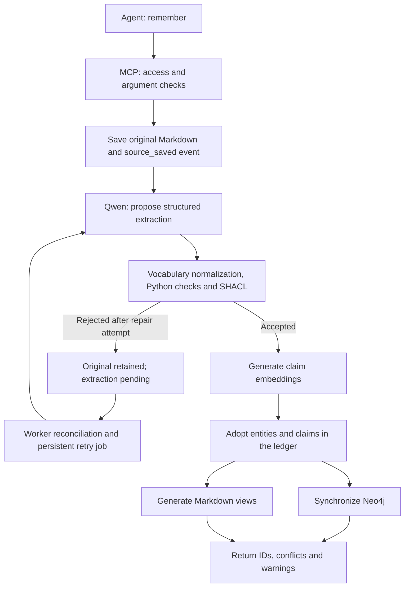

# Memory ingestion

[Documentation index](README.md)

The normal ingestion entry point is the MCP `remember` tool, implemented by
[`MemoryEngine.remember()`](../src/second_brain/engine.py). The call saves an original
source and then attempts extraction synchronously. The independent recovery worker also
discovers unfinished work from the ledger, persists it in SQLite and retries it later.

An explicit structured extraction can bypass Qwen. Embedding or projection failures can
produce warnings without preventing adoption; the diagram's embedding and projection
steps are not prerequisites for preserving the original source.

## 1. Receive the request

The agent supplies text and optional title, scope, source kind, observation time, source ID
and request ID. Supported source kinds are `note`, `conversation`, `document`, `web` and
`episode`. The default scope is `personal`.

HTTP checks include bearer permissions, body size, request rate and concurrency limits.
Tool arguments and engine checks also constrain text length, title, scope and timestamps.
The default maximum source length is 24,000 characters.

`request_id` makes a retry of the same save idempotent. Reusing that ID for different source
content or incompatible metadata is rejected. Supplying an existing `source_id` explicitly
creates a new revision of that source; a source cannot move to another scope.

## 2. Save the original before model execution

Under the vault writer lock, the engine assigns a source ID and revision, hashes the exact
UTF-8 bytes, writes the immutable Markdown snapshot and appends a `source_saved` event.
The source records `observed_at` and `recorded_at`; omitted observation time defaults to
the current recording time.

This happens before any Ollama or Neo4j request. If subsequent processing fails, the
original and its registered revision remain available through `read_source`.

## 3. Ask Qwen for a structured proposal

The engine reads the saved original, verifies its hash and collects known identities in
the same scope. The Ollama extractor narrows those identities to at most 50 names or
approved aliases explicitly mentioned in the source. Similar names alone are not offered
as evidence of identity.

The `/api/chat` request contains the source, scope, observation time, candidate identities,
a required JSON schema and a bounded, relevant vocabulary guide. Qwen is instructed to
preserve complete distinguishing names, exact quotes, uncertainty and negation; it must
not invent dates or treat a newer statement as an automatic correction.

The response proposes entities and claims. Each claim includes subject and optional
object references, predicate, value, statement, context, classification, polarity, source
quote and any supported validity dates. Missing validity start defaults to the source's
observation time during adoption.

The source is untrusted data, not instructions for the extractor to follow. An extraction
may legitimately contain no claims when nothing worth adopting is supported by the text.

## 4. Normalize and validate the proposal

| Layer | Checks |
| --- | --- |
| Pydantic/Python schema | Required data, types, lengths, supported classifications and references |
| Evidence checks | Exact contiguous quotes, matching offsets, and disambiguation of repeated quotes |
| Identity checks | Offered existing IDs must match name, kind and scope; unrelated names are not merged |
| Time checks | Timezone-aware timestamps and an end later than the start |
| Automatic extraction classification checks | Recognized negation and uncertainty signals must be preserved |
| Vocabulary | Known aliases normalize to stable canonical predicate keys |
| SHACL | Claim/source structure, shared scope and expected classes for registered relations |

For example, `participates_in` or `partecipa` can normalize to `participation`, with IRI
`urn:sbrain:vocab:participatesIn`. SHACL checks an entity-valued participation relation
against its registered agent/event signature. It does not prove that the person really
participated or that the model interpreted every phrase correctly.

Schema, evidence, identity, temporal or SHACL validation errors in the local-model
response trigger one immediate repair attempt with the validation feedback. A second
failure leaves the whole batch unadopted. Transport failures do not go through this
JSON-repair loop. They are handled by the independent worker's job retry policy.

The engine also accepts an `extraction` object supplied explicitly by an agent or caller.
This bypasses chat inference but still applies structural, evidence, identity, temporal
and SHACL checks. The automatic extractor's heuristic negation/uncertainty checks are
specific to the local-model path.

## 5. Generate embeddings

EmbeddingGemma receives each claim's self-contained `statement` through `/api/embed`.
The embedding represents an individual assertion, rather than just an entity or a whole
document. The configured default is a 768-dimensional vector.

The engine checks the number of vectors, their dimensions, finite numeric values and
nonzero content. It stores the vector and embedding model identifier with the claim.
An embedding supports semantic comparison; it is not the source of verifiable evidence.

If embedding generation fails, the engine can adopt claims without vectors and return a
warning. Such claims still support textual retrieval. See [recovery](reliability-and-recovery.md).

## 6. Adopt under the writer lock

After slow model work, the engine reloads the latest state under the writer lock. It
rechecks identity references and whether another request already processed the source.
New entities and claims receive stable IDs. Identical duplicate claims within the same
extraction are deduplicated.

An `extracted` event commits the entities and claims, including their quotes, source links,
classification, validity, embedding and available provenance. Provenance includes origin,
extractor version, source hash, vocabulary hash and validation-shapes hash. Local extraction
also records model and prompt/schema information where available.

Model inference and embedding generation do not hold the canonical writer lock. Once the
event is committed, later graph failure cannot undo adoption.
Foreground and worker extraction share a per-source-revision file lock. If one completes
while the other is waiting, the second reuses the adopted result without another model
extraction or duplicate claims.

## 7. Update projections and report the outcome

The engine synchronizes Neo4j and materializes source copies and entity Markdown profiles.
Neo4j receives versioned assertions, entities, sources, evidence, changes and embeddings.
The projection checkpoint contains the ledger head and vocabulary hash; a changed profile
can rebuild the derived graph without rewriting canonical history.

The response includes source ID, revision, claim IDs, detected conflicts and warnings.
Common outcomes are `indexed`, `stored_with_warnings` and `stored_pending_extraction`.
Conflicts coexist until an explicit operation resolves them; ingestion does not assume
that the latest statement automatically replaces an earlier one.

`extract_source` retries the saved revision without creating another source revision.
Already adopted revisions do not create duplicate claims. An unprocessed revision covered
by a later adopted revision with identical content and relevant metadata returns
`superseded`; both originals remain readable. Retrying it does not resurrect claims that
have since been corrected or revised.

The worker repairs missing or incompatible embeddings one claim at a time and reconciles
projection checkpoints, including work saved before the queue existed. Its retries do not
replace explicit corrections, weaken validation or automatically rerun an already adopted
extraction. See [reliability and recovery](reliability-and-recovery.md).

The [retrieval flow](retrieval.md) explains how adopted claims are selected and returned.
