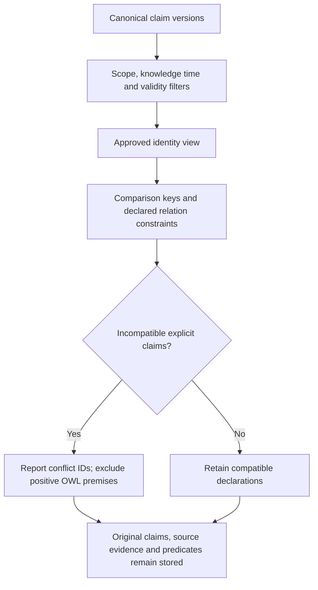

# Memory consistency

The engine keeps source declarations, uncertainty and history. A conflict is a signal
that two declarations cannot both hold under the comparison policy; it does not select
a true statement, overwrite a memory or authorize an automatic correction.

## One comparison policy

[`ConflictIndex`](../src/second_brain/consistency.py) is used by ingestion responses,
`recall` and the RDF/OWL premise filter. It operates on the chosen canonical snapshot,
using approved identities at `valid_at` and `known_at`. Ingestion considers active
versions with overlapping validity intervals, including future intervals. A retry of
an old source compares its current version and cannot revive a withdrawn assertion.
An `entity_id` retrieval filter limits returned memories, while conflict detection
still uses the full temporally visible scope. Competing targets or literal denials
can therefore appear as conflict IDs even when those claims are outside the selected
entity's returned results. Scope and both temporal filters continue to apply.

The rules are:

- An affirmation and a denial conflict only for the same target.
- Different positive targets conflict only for a property declared
  `single_in_context`. Two preferences or two participations can be compatible.
- Two denials of different targets do not create a single-value conflict.
- Proposed and inferred claims do not conflict as explicit declarations.
- Nonoverlapping intervals, different scopes and authoritative manual contexts remain
  separate. Current and historical queries use the same comparison rules.
- Typed targets are compared through canonical IDs, including approved temporal merges.
  Their readable values do not replace object identity. Inverse and symmetric properties
  are oriented for comparison; single-value constraints on either direction are retained.
- A legacy text-only relationship can match a descriptive value such as `yes` to a
  typed target only when the comparison group contains one matching typed target.
  Only targets whose validity overlaps the compared assertions participate in this
  choice. Expired unrelated targets cannot make a current comparison ambiguous;
  overlapping ambiguous legacy values do not identify an entity.

## Literal and entity-valued preferences

`preference`, `prefers` and `preferred_by` retain distinct stored predicates and IRIs.
There is no new vocabulary alias or OWL property equivalence.

A literal `preference` can share a comparison key with `prefers` only when its recorded
evidence contains a recognized explicit preference verb, the complete owner/target
match, and polarity agrees. Wanting/desiring something does not license this bridge.
Resolving a literal target to an entity requires a unique known identity with that exact
source-grounded name in the same scope. Multiple homonyms remain ambiguous; the bridge
does not create an entity or merge identities. `preferred_by` is compared in its
declared inverse direction.

For example, `Nora Bell preferisce il tè nero speziato` and
`Nora Bell non preferisce il tè nero speziato` are conflicting declarations when their
identities and applicable contexts match, even if different accepted representations
were used. Preferring tea and preferring coffee are compatible declarations.

This comparison bridge prevents a conflicting typed positive claim from becoming an
OWL premise. It does not assert an entity-valued triple from a literal preference or
produce a new deduction. The reasoner still runs only when explicitly requested.
Premise selection uses the shared conflict result rather than comparing raw literal
values against entity IRIs a second time. Text-only object relationships remain
excluded from positive OWL premises; a compatible legacy literal does not discard
an independently supported typed premise. Contradictions introduced by OWL closure
still suppress relationship deductions.

## Context authority

Under `source-contracts-v6`, automatic extraction uses `context=default`. Current
deterministic contracts retain the complete subject, target and qualifiers from each
source clause, but do not recognize an independent contextual qualifier. A model-chosen
topic such as `drinks` or `favorites` cannot partition the same fact to avoid conflicts.
The proposed label is retained in normalization provenance.

If a statement requires a distinction not expressible by the current source contracts,
keep it for review or submit an explicitly reviewed structured extraction. Explicit
manual contexts are preserved, including contexts inherited by corrections.

Older automatic labels remain in the immutable ledger and returned claim records.
Conflict comparison treats their labels as `default`, following correction ancestry
when necessary. It does not rewrite stored contexts, entity profiles or historical RDF
graphs. Unrelated legacy OWL contexts are not automatically regrouped; identified
conflicting positive premises are excluded before reasoning across these records.

## Deduplication boundaries

Within one automatic extraction, each accepted claim binds to a source witness with
exact offsets. Equivalent claims for the same witness become one claim, including
copies differing only in their model-chosen context or covering quote. All supplied
quotes and references must pass their checks before deduplication. Source-contract
normalizations and duplicate removal are recorded in provenance.

Two candidates for one witness with different identities, intervals, polarity,
certainty or predicates reject the entire batch. The engine never selects the more
convenient candidate to hide an error. Retained claims pass temporal grounding and
the remaining acceptance checks. Separate source occurrences and separate sources
retain their evidence; retries reuse the original source revision and adopted claim IDs.
Existing stored duplicates are not deleted or migrated automatically.

## Verification

[`test_consistency.py`](../tests/test_consistency.py) exercises deterministic model
responses through the real extraction checks and engine. It covers cross-form
preferences, compatible targets, contexts, incompatible duplicates, source/retry
integrity, homonyms, approved temporal merges, inverse/symmetric constraints, validity
boundaries and exclusion of conflicting OWL premises. These tests complement the live
Ollama, Neo4j and worker recovery tests; they are not a new model-accuracy benchmark.
