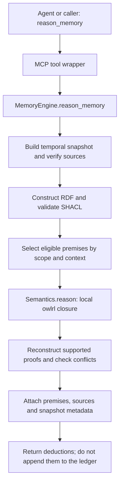

# Reasoning and agent decisions

[Documentation index](README.md)

The project supports local formal reasoning through `reason_memory`. Reading vocabulary
definitions and executing those rules are different operations.

## Who decides to request deductions

Currently, the agent calling the MCP server chooses whether to invoke `reason_memory`.
The user can explicitly ask for deductions, and another caller can invoke the tool or
the CLI directly. The MCP server does not independently classify every question and
decide to run OWL.

```text
User question
     ↓
Agent chooses tools:
  recall         → search recorded claims
  reason_memory  → request formal deductions
     ↓
Server executes the selected tool
```

The MCP instructions explain when reasoning is useful, and `knowledge_schema` exposes
definitions, class hierarchies, aliases and rule flags. A separate skill is not technically
required to call these tools. However, instructions do not guarantee that a model will
choose them. A client may not expose every instruction, and an agent may use only `recall`
or reason in natural language without executing the formal reasoner.

Once `reason_memory` is called, the declared rules and eligible premises determine the
formal conclusions. The language model does not decide which OWL rules are logically valid.

## Where reasoning fits in the workflow

```text
remember
  → source → extraction → SHACL validation → embeddings → ledger → Neo4j

recall
  → temporal filters → text/vector search → shared entities → recorded memories

reason_memory
  → temporal snapshot → SHACL validation → OWL reasoner → deductions with premises
```

Neither `remember` nor `recall` automatically calls `reason_memory`. Reasoning is commonly
requested while answering a question, but a caller can invoke it after ingestion or at
another time. SHACL validation during ingestion is not OWL reasoning.

`reason_memory` builds its own snapshot for the requested scope and dates. It does not
automatically receive only the results of the preceding `recall` call, and its input is
not selected by the previous query's vector ranking.

## Exact execution path



The MCP wrapper calls `MemoryEngine.reason_memory()`, which invokes
`Semantics.reason()` after constructing and validating the snapshot. The `owlrl` library
executes OWL 2 RL rules inside the existing MCP container. This operation does not need
Ollama, an embedding calculation, a Neo4j search, another reasoner container or a paid API.

## Premises and supported conclusions

The engine admits compatible registered relations from explicit positive claims. Contexts
are evaluated independently within a requested scope and temporal view. Proposed claims,
source claims already classified as inferred, explicit negations, incompatible legacy
relations and unregistered predicates are not positive relationship premises.

Negations still matter: explicit denials are checked for contradictions. Known conflicts
are excluded from eligible premises. If the closure contradicts a denial or a configured
single-value constraint, relationship deductions for that context are suppressed with a
warning. Entity class inheritance can also produce type deductions with classification
provenance.

| Rule | Example |
| --- | --- |
| Inverse property | `Luca participatesIn Trip` implies `Trip hasParticipant Luca` |
| Symmetric property | `A knows B` implies `B knows A` |
| Transitive property | `A partOf B` and `B partOf C` imply `A partOf C` |
| Class hierarchy | An instance of `Meeting` is also an `Event` |

For example, if a user asks how A relates to C and the memory only states the two `partOf`
premises, the agent can request the transitive conclusion with its formal proof.

The reasoner computes an OWL RL closure. The application returns only supported
inverse/symmetric/transitive/class conclusions whose premises it can reconstruct. It
filters bookkeeping triples and does not automatically merge entities through `owl:sameAs`.
This is not unrestricted OWL DL reasoning or an arbitrary rule-execution endpoint.

## Returned deductions and persistence

Each deduction is marked `epistemic=inferred` and carries premise claim and/or entity IDs,
rule names and source references. The response includes the selected dates, scope,
vocabulary hash and `saved=false`.

Deductions are computed on demand and are not appended as new memories. They follow from
declared premises; they are not independent verification of real-world truth. A later
correction, retraction or different snapshot changes the next computation.

Requests are bounded: the default semantic snapshot limit is 250 visible claims, and there
are also proof/closure and context budgets. A context filter narrows reasoning, but the
scope's snapshot is constructed before that filter; it does not bypass the snapshot claim
limit. Oversized requests fail explicitly instead of silently dropping required premises.

## Related tools and examples

Use `knowledge_schema` to inspect definitions, `validate_knowledge` for a SHACL-only audit
and `export_rdf` to export a selected RDF view with provenance and both time axes. These
read-only tools do not create another persistent database.

MCP arguments:

```json
{"scope": "demo", "context": "attendance", "limit": 30}
```

CLI equivalent:

```bash
docker compose exec -T mcp second-brain reason --scope demo --context attendance
```

For vocabulary coverage, extension configuration and RDF formats, see the
[knowledge reference](knowledge.md).
