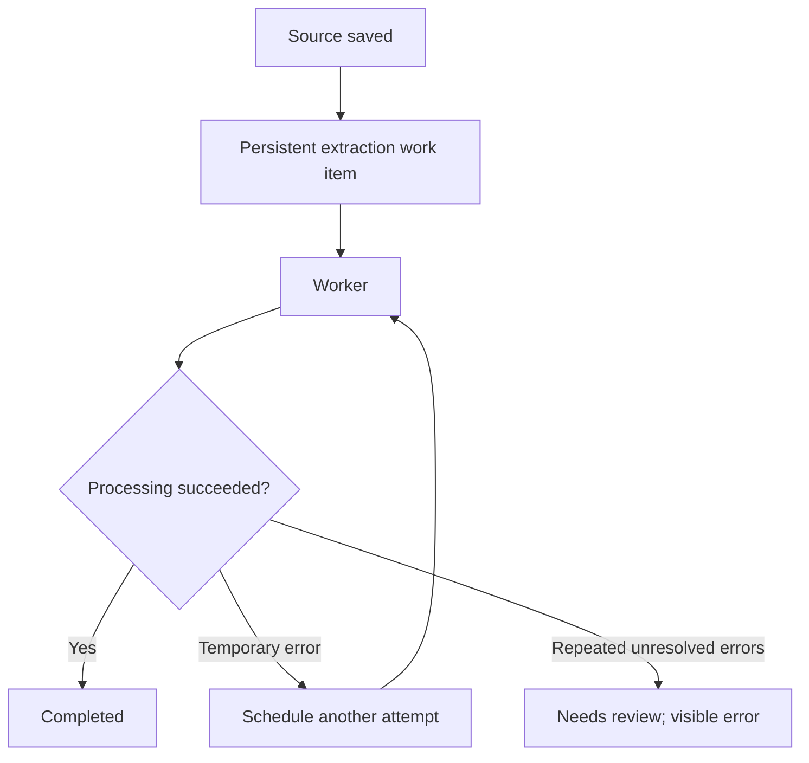

# Reliability and recovery

[Documentation index](README.md)

**Current behavior:** original sources are preserved before extraction, but there is no
autonomous worker that guarantees later completion of failed extraction or missing
embeddings. An original can remain saved without adopted, searchable claims.

The persistent worker described below is a proposed improvement, not an implemented service.

## What is automatic today

| Situation | Current behavior | Follow-up |
| --- | --- | --- |
| Invalid local-model extraction | One immediate repair attempt using validation feedback | After another failure, call `extract_source` explicitly |
| Ollama transport failure during extraction | Preserve the original and report pending extraction | Retry the saved revision when the dependency is available |
| Embedding generation fails | Claims can be adopted without vectors, with a warning | Explicitly run CLI `reembed` |
| Neo4j projection fails | Preserve canonical data and report a warning | Later reads/writes try synchronization again; CLI `replay` can force rebuilding |
| Derived Markdown view fails | Preserve committed data and report a warning | A subsequent materialization attempt or `replay` can repair views |
| An interrupted final ledger append | Preserve the incomplete tail in `recovery/` and recover complete preceding events when reading | Other corruption fails explicitly rather than being silently accepted |

The local-model repair loop handles invalid extracted JSON and its validation errors. It
is not a general retry loop for HTTP failures and does not schedule work after returning.

## Pending extraction

After repeated validation failure, the response includes `stored_pending_extraction`, the
source ID and revision, and warnings. The source can still be read, but no claims from
that failed batch have been adopted.

`memory_status.pending_extraction` lists revisions requiring processing. This information
survives a restart because it is derived from saved sources and extraction events. A
restart itself does not start processing the backlog.

MCP exposes `extract_source` and instructions to retry a saved revision. A skill is not
required to call the tool. Nevertheless, a model's willingness to follow those instructions
is not a reliable scheduler, and the conversation can end before another call happens.

For example, call `extract_source` with the actual source UUID and revision returned by
`remember`. It can also accept a reviewed structured extraction when automatic extraction
cannot resolve the source reliably. Successful or superseded revisions are idempotent and
do not duplicate their claims.

## Missing embeddings

Ingestion returns an embedding warning and `memory_status.embeddings_missing` reports a
count. Neither response automatically schedules regeneration.

`reembed` is currently a CLI maintenance command, not an MCP tool. An agent connected only
through this MCP can inspect the problem but cannot directly invoke that maintenance
operation. The current command recomputes embeddings for all claims in its initial
snapshot, including claims that already have vectors. Concurrent additions are left for
a subsequent invocation.

Missing embeddings do not prevent lexical retrieval. A source with no successful
extraction is a different condition: it has no adopted claims for `recall` to rank yet.

## Neo4j and generated views

Neo4j is a derived projection. Later `recall` calls and relevant write operations attempt
to synchronize it again, and unchanged checkpoints avoid unnecessary projection work.
This is request-driven recovery, not periodic monitoring; no new requests means no
scheduled synchronization attempt.

`replay` verifies saved originals and forces reconstruction of Neo4j and generated
Markdown views without reinterpreting sources through Qwen. It does not perform pending
extraction or generate missing embeddings.

## Operator commands

Run these from the repository after starting the Compose services:

```bash
# Inspect pending extractions, missing embeddings and dependency status.
docker compose exec -T mcp second-brain status

# Replace SOURCE_ID and REVISION with a saved revision's actual values.
docker compose exec -T mcp second-brain extract SOURCE_ID --revision REVISION

# Recompute embeddings for the current claim snapshot.
docker compose exec -T mcp second-brain reembed

# Verify originals and rebuild derived graph/Markdown views.
docker compose exec -T mcp second-brain replay
```

Read the returned warnings. CLI exit code `0` indicates success, `2` indicates warnings or
incomplete processing, and `1` indicates an error. The current `/health` endpoint checks
transport liveness only; `memory_status` checks storage state and dependencies.

## Proposed persistent recovery worker

To make completion independent of an agent's choices, recovery should be owned by the
backend. A persistent queue would track extraction, embedding and projection work; a
worker would resume it after dependency outages or process restarts.



The proposed mechanism should retain work identity, status, attempt count, last error and
next execution time. It should use delayed retries for transient dependency failures,
resume interrupted work after restart and make operations idempotent so recovery cannot
duplicate sources or claims. The same approach can track missing embeddings and stale
projections without asking a chat agent to notice them.

This would make recovery autonomous, but it would not guarantee that a small model can
interpret every source correctly. Persistent validation failures must become a visible
`needs review` state, with the original preserved, rather than silently marking a source
as successfully processed or weakening evidence requirements.

No such queue, scheduler or automatic `needs review` workflow is currently implemented.
