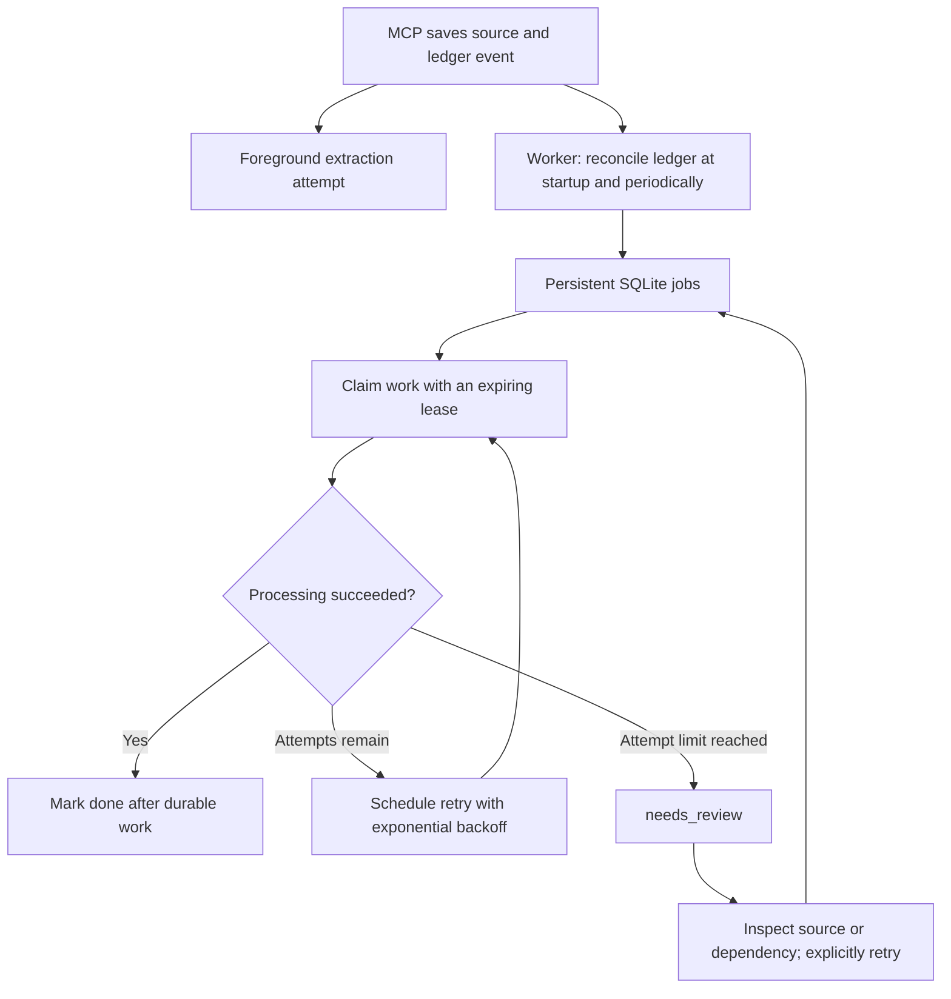

# Reliability and recovery

[Documentation index](README.md)

Compose runs an independent `worker` service and a persistent SQLite queue. Recovery does
not depend on the agent choosing another tool, keeping a conversation open or having a
skill. Original sources and the event ledger remain authoritative; SQLite tracks work.

## Automatic recovery flow

`remember` still saves an original before making model calls and attempts extraction in
the foreground. At startup and approximately every 15 seconds between jobs, the worker reconciles the
canonical ledger with the queue. It discovers unprocessed source revisions, claims with
missing/incompatible embeddings, and stale Neo4j or generated Markdown projections.



Reconciliation closes the gap between committing a source and scheduling its job. The
vault and SQLite are not one atomic transaction: if the process dies between them, the
next scan reconstructs the missing obligation. Existing incomplete memories are picked
up without being reimported.

`remember` can therefore return `stored_pending_extraction` while the worker later
processes that same revision. It does not claim that background work is already complete.

## Work identities and states

| Kind | Work identity | Operation |
| --- | --- | --- |
| `extraction` | Vault and source revision | Call the existing validated `extract_source` path |
| `embedding` | Vault, claim and configured model/dimensions profile | Repair that claim's vector without re-extracting or changing its status |
| `projection` | One coalesced views job per vault | Synchronize Neo4j and materialize Markdown from current canonical state |

Jobs have stable IDs, generation identifiers, attempt counts, due times, lease tokens,
lease expirations, timestamps and safe error codes. Public inspection excludes lease
tokens and source contents. Timestamps in job responses are Unix seconds.

```text
pending → running → done
             ├──→ retry_wait → running
             └──→ needs_review → explicit retry → pending

running with an expired lease → pending, or needs_review at the attempt limit
```

The default maximum is five worker attempts. The extractor can itself make one immediate
JSON-validation repair within an extraction attempt. Transport errors skip that inner
repair loop but still receive worker retries.

Retry delays grow exponentially from 30 seconds up to 3,600 seconds, with 0.8–1.0 jitter.
Transient dependency outages and repeated validation errors are bounded by the same job
attempt limit. A long outage can therefore reach `needs_review`; after fixing it, an owner
explicitly resets that job. The queue does not retry review jobs indefinitely.

Unchanged reconciliation scans preserve retry delays and review states. If the canonical
work has been completed manually or superseded, reconciliation resolves the corresponding
non-running job. A genuinely new projection generation reopens work for the newer state.
That is separate from a timed retry of the unchanged generation.

## Restart, concurrency and crash safety

SQLite lives at `/data/jobs/queue.sqlite3` on the `jobs_data` Docker volume, mounted by
both application services. It uses short `BEGIN IMMEDIATE` transactions, a busy timeout,
SQLite's rollback journal and `synchronous=FULL`. No additional queue broker or Python
package is required. Keep the directory on local storage, rather than a network share.

The one-shot `queue-init` service applies private directory/file permissions and the
configured container UID/GID. MCP and the worker run without root privileges. Source
text, embedding vectors, model responses and raw exception messages are not stored in
the queue. Error codes identify the failing stage and exception class.

Each claimed job gets a fenced lease. A heartbeat thread renews the active lease while
slow model or database work runs. A killed process cannot renew it; a new worker can reclaim
the job after expiry, at most the configured lease interval after the last renewal.
Restarting does not immediately steal a still-valid lease. Repeated interrupted attempts
can also reach review.

One worker loop per vault is enforced with a process file lock. Foreground and worker
extraction additionally share a per-revision lock, preventing redundant extraction calls for the
same source. Slow model work does not hold the canonical ledger writer lock.

Delivery is at least once. Extraction rechecks adoption before commit; embedding repair
rechecks whether a compatible vector is already present; projection writes are rebuildable.
A crash after the durable operation but before job acknowledgment therefore does not
require a duplicate claim or embedding event. Old lease tokens cannot acknowledge another
execution, and an older projection generation cannot acknowledge newly requested work.

Embedding repair includes historical/retracted claims so historical retrieval retains its
vectors, but does not resurrect them. A configured model/dimension change makes incompatible
vectors eligible for repair. Mutable model tags are not content-addressed model identities:
use a distinct configured model name or run `reembed` when replacing weights under the
same tag.

Projection reconciliation checks the actual Neo4j checkpoint and local view marker, not
only a queue `done` flag. The Neo4j checkpoint includes vocabulary and embedding-profile
identity. Missing/recreated databases or changed profiles can trigger rebuilding.

## Start and inspect

From the repository:

```bash
./scripts/init.sh
docker compose up -d --build
docker compose ps -a
docker compose logs --tail=100 worker
docker compose exec -T mcp second-brain status
docker compose exec -T mcp second-brain jobs --status needs_review
```

Normal shutdown/restart preserves work:

```bash
docker compose down
docker compose up -d --build
```

Do not add `-v` for an ordinary restart: that removes named volumes, including queue
attempt/review history, Neo4j data and model files. If the queue alone is lost, the worker
can rediscover incomplete work from the vault, but previous review decisions are lost.

The worker handles SIGTERM/SIGINT by stopping after its current operation. Compose allows
30 seconds for shutdown; a longer active call may be killed and recovered through its
lease. No agent interaction is needed for that restart path.

`memory_status.recovery` reports availability, counts by state, `worker_alive`, last
heartbeat and the first review jobs. `embeddings_missing` counts absent vectors;
`embeddings_incompatible` also includes model/dimension mismatches. `recovery_jobs` lists
jobs with optional `status`, `limit` and `offset`, and returns `next_offset`.

`worker-health` is the Compose health check. It verifies a recent non-stopped heartbeat,
not that every dependency or job is healthy. The heartbeat remains active during long
work. Inspect backlog/review state and dependency status separately. Outside Compose,
`memory_status.recovery.enabled=false` means no queue path was configured.

## Review and operator commands

Inspect a failed source with `read_source`, check identity/SHACL issues or restore a missing
dependency. The source remains saved and validation is not weakened to make a job pass.
Use a reviewed structured `extract_source` input if the local model cannot resolve it.
Once manual extraction succeeds, reconciliation observes the completion.

To retry a job, replace `JOB_ID` with the ID returned by `jobs` or `recovery_jobs`:

```bash
docker compose exec -T mcp second-brain retry-job JOB_ID
```

The MCP `retry_job` tool takes `job_id`. It requires write credentials, resets attempts
and makes a pending/retry/review job immediately eligible. It rejects running, completed
or unknown jobs and cannot access another vault's jobs. Read-only credentials can inspect
the queue but cannot requeue work.

Explicit maintenance commands remain available:

```bash
# Retry one original revision now; replace SOURCE_ID and REVISION.
docker compose exec -T mcp second-brain extract SOURCE_ID --revision REVISION

# Recompute all claim embeddings in the current snapshot, including existing vectors.
docker compose exec -T mcp second-brain reembed

# Verify originals and force rebuild graph and Markdown views, without chat extraction.
docker compose exec -T mcp second-brain replay
```

`reembed` is a CLI command, not an MCP tool. The worker repairs individual missing or
incompatible vectors automatically instead. `replay` does not perform pending extraction
or calculate embeddings. CLI exit codes remain `0` for success, `2` for warnings/incomplete
processing and `1` for errors.

## Configuration and non-Compose use

| Setting | Default | Meaning |
| --- | --- | --- |
| `SB_WORKER_QUEUE_PATH` | `/data/jobs/queue.sqlite3` in Compose; disabled outside Compose | Private persistent database shared by the MCP and worker processes |
| `SB_WORKER_POLL_SECONDS` | `2` | Idle interval before looking for due work |
| `SB_WORKER_RECONCILE_SECONDS` | `15` | Interval between canonical backlog scans |
| `SB_WORKER_LEASE_SECONDS` | `60` | Active work lease, renewed by heartbeat |
| `SB_WORKER_MAX_ATTEMPTS` | `5` | Attempts before `needs_review` |
| `SB_WORKER_RETRY_BASE_SECONDS` | `30` | Initial exponential retry delay |
| `SB_WORKER_RETRY_MAX_SECONDS` | `3600` | Maximum retry delay before jitter |

Outside Compose, set an absolute `SB_WORKER_QUEUE_PATH` and use the same vault, models,
vocabulary extension and queue settings for both processes. Run `second-brain worker`
as a supervised process. Long-running jobs can delay the next reconciliation; lease
heartbeats run independently throughout. `worker --once` reconciles and processes at most one due job;
it does not drain a whole backlog. A second worker for the same vault is rejected by
the leader lock.

Successful extraction is not guaranteed for arbitrary text. Persistent ambiguity remains
visible as `needs_review`, preserving the original and evidence requirements. Recovery
does not capture conversations automatically or run/save OWL deductions.

The complete fault/restart/review scenario is part of the automated suite. See
[automated worker recovery tests](testing.md) for repeatable Docker and local commands,
assertions, diagnostics and isolation guarantees.

SQLite references: [transactions](https://sqlite.org/lang_transaction.html) and
[synchronous durability settings](https://sqlite.org/pragma.html#pragma_synchronous).
