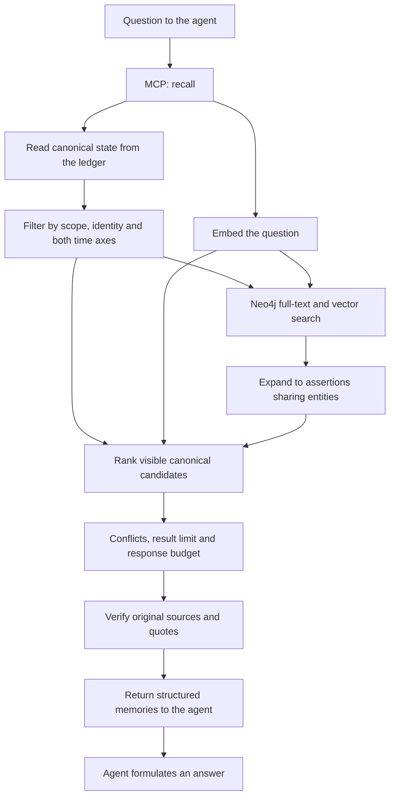

# Memory retrieval

[Documentation index](README.md)

The `recall` tool retrieves recorded claims using lexical matching, vector similarity and
graph proximity. It does not automatically execute OWL reasoning. The ordinary retrieval
path uses the embedding model, not Qwen's chat extraction model.



## 1. Choose the query and any exact identity

The agent supplies the question and optional `scope`, `entity_id`, `valid_at`, `known_at`,
`include_uncertain`, `limit` and `token_budget` parameters.

When a question concerns one precise person or event, the agent can use `find_entities`
first and pass the resulting ID to `recall`. A semantically similar search hit is not
proof of identity. Without an exact filter, broad searches can return related people,
events or similarly named tests in the selected scope.

## 2. Construct the visible candidate set

The engine reads the ledger and obtains its canonical state. It reuses a cached state
when the ledger head has not changed and incrementally applies new events where possible.

It selects active assertion versions matching the requested scope and time snapshot:

| Parameter | Question answered |
| --- | --- |
| `valid_at` | What information applied at that time? |
| `known_at` | What versions did the engine know at that time? |

Both default to now. Interval starts are inclusive and ends exclusive. Retracted versions
do not appear in the corresponding current view, but earlier knowledge views remain
queryable. Explicit aliases and merges are resolved for the same requested times.

By default, `recall` includes only `epistemic=explicit` claims. Set
`include_uncertain=true` to include proposed and inferred source claims. An explicit
negative assertion remains eligible; negation is not uncertainty.

An `entity_id` restricts candidates to that canonical identity as subject or object,
including explicitly approved merges applicable to the snapshot.

## 3. Embed the question

The engine asks Ollama's embedding endpoint to represent the question with the configured
embedding model. A claim vector is compared only when its model identifier and dimensions
match the query configuration.

The model places semantically related texts near each other in vector space. Cosine
similarity measures their alignment. This comparison helps find memories that do not use
the exact words in the question, but it is not an identity check or a truth score.

If query embedding fails, the engine reports a warning and continues with textual search.

## 4. Search Neo4j and expand through shared entities

Before search, the engine attempts to bring Neo4j's derived projection up to date. The
search combines a full-text index and a vector index, with vault, scope, time, uncertainty
and optional exact-identity constraints. The default search candidate limit is 200.

Neo4j's vector procedure selects its initial candidates before namespace and temporal
filters are applied. The canonical search described below therefore remains important;
unrelated or historical index entries must not hide every eligible memory.

Graph expansion starts from up to 20 assertion IDs with the highest search contributions.
It finds other visible assertions linked to the same subject or object entities:

```text
Starting assertion
   ─ ABOUT or OBJECT → Entity ← ABOUT or OBJECT ─ Related assertion
```

The starting points are assertions found through text and vectors. Expansion follows
shared entities; it is not an unrestricted traversal along every possible relationship
or a formal OWL deduction.

Neo4j contributes rank-based scores from full-text and vector results. Related assertions
receive a small fallback contribution if they do not already have a search score.

## 5. Rank canonical candidates

The engine also scores every eligible canonical claim using word overlap and exact
cosine similarity over its stored vector. This preserves historical retrieval when the
approximate vector index's candidate limit contains many inactive or foreign versions.

Lexical matching covers the statement, value, subject/object names and approved aliases,
context and predicate. The current scoring formula is:

```text
score = lexical coverage
      + 0.6 × max(0, cosine similarity)
      + Neo4j search contribution
```

Lexical coverage is the fraction of distinct question terms found in the claim's search
text. A candidate is included when it has a lexical match, cosine similarity of at least
0.35, or a Neo4j contribution. Scores order relevance, not reliability or factual truth.

The exact canonical pass scans the visible candidate set. Its work grows with the number
of visible claims, even though Neo4j supplies indexes and graph contributions.

## 6. Attach conflicts and enforce response bounds

The engine groups claims by scope, canonical subject, predicate and context. It reports
other visible explicit claims with a different value or polarity as conflicts. This is a
conservative structural comparison, not a universal semantic contradiction detector.

The default result limit is 10. The default response budget is approximately 4,000 tokens,
estimated as four characters per token over serialized items. Whole items that do not
fit are omitted rather than cutting their evidence in the middle. The result indicates
whether it was truncated.

## 7. Verify evidence and return structured data

For the memories selected for return, the engine reads the necessary immutable originals,
checks their hashes and verifies the exact quoted character slices. A request-local cache
avoids rereading the same source repeatedly.

Results contain claim data, subject/object entities, canonical identity IDs, dates,
classification, predicate IRI, score, source IDs, revisions, quotes, conflicts and warnings.
Raw embeddings are excluded from the ordinary result.

The agent then writes its answer using this evidence. It can request full originals with
`read_source`, inspect one claim and its history with `explain`, or explore broader history
with `history`. Retrieved text remains untrusted source material, not new instructions.

If Neo4j is unavailable, canonical lexical matching and any available exact vector
comparisons still operate. If models are also unavailable, lexical retrieval remains.
An original saved without a successful extraction has no adopted claims to rank yet; see
[reliability and recovery](reliability-and-recovery.md).

Formal deductions require a separate [reasoning request](reasoning.md).

The independent worker discovers pending extraction and repairs embeddings/projections in
the background. It does not block every `recall` until the backlog is empty: an unfinished
source still becomes searchable only after successful adoption. Use `memory_status.recovery`
or `recovery_jobs` to inspect backlog and `needs_review` rather than assuming a successful
text save means complete indexing.
