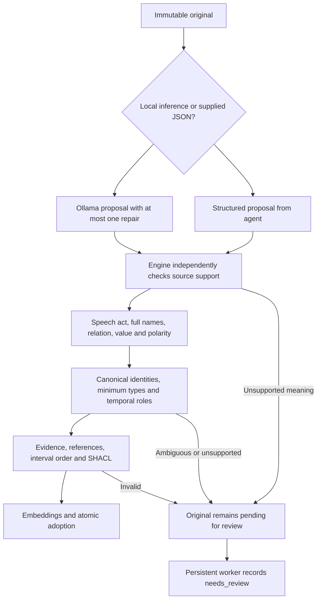

# Semantic safety and trust boundaries

[Documentation index](README.md)

Source-contracts-v8 addresses the counterexamples found in the October 18 semantic
audit. It distinguishes a source-supported assertion from a plausible interpretation.
A verbatim quote, valid JSON, compatible type and successful SHACL check are necessary
checks, but do not by themselves establish the meaning of an assertion.

## Ordinary ingestion



`remember` saves the original before interpretation. `extract_source` retries that same
revision. Both tools treat a supplied `extraction` as an untrusted proposal. Structured
JSON skips chat inference, and never skips source contracts. The engine checks this
boundary independently even when an adapter returns an already-validated draft.

| Counterexample | Enforced behavior |
| --- | --- |
| `Marta Riva lavora per Officina Cedro?` | A question supplies no employment witness. Empty extraction is valid; repair requests abstention rather than a declarative fact. |
| Positive claim quoting `Nora Bell non partecipa alla Riunione Nord.` | Rejected on the structured MCP path as well as local inference. |
| Two canonical people named `Nora Bell` | Selecting either offered UUID is insufficient identifying evidence; both choices remain ambiguous. |
| Two records already merged by the owner | Candidates contain one canonical ID with approved aliases, avoiding false ambiguity. |
| Destination of `Gita del 18 ottobre 2027 alle 09:00 (UTC+02:00)` | The timestamp identifies the event. It is not the destination claim's effective time. |
| `Nora Bell works for Cedar Labs.` with target type `company` | A new target is normalized to `organization`. The phrase does not establish company/team/institution. |
| `Nora Bell partecipa alla Riunione Nord solo se Marco conferma.` | The condition is not made part of a fictitious event name and cannot become certain participation. Unsupported logic stays pending. |

Speech acts are checked before removing terminal punctuation, including `?!` and Unicode
question punctuation. Query parameters inside a URL are preserved. Recognized questions
can coexist with statements in one note: only the declarative witnesses require coverage.
Unknown substantive language still keeps the complete batch unadopted. There is no
general natural-language completeness guarantee.

Conditions and disjunctions are not first-class logical facts in this version. Explicitly
quoted names and URLs are opaque for operator detection, so an operator inside a quoted
organization name does not automatically become a condition. Ambiguous unquoted names
can require review. Ordinary `and` in `Research and Development` remains usable.

An explicit effective/decision prefix must use an unambiguous zoned timestamp and be
included in the evidence. A bounded interval must preserve both bounds. Dates in names,
deadline values or other facts do not supply validity. With no effective prefix, the
default remains the source's `observed_at`.

## Types and OWL support

New source-bound entities use minimum role classifications licensed by the selected
relations. A name alone does not establish a person, company, meeting or other subtype.
Compatible offered identities retain their stored kinds. The normalizer records each
type adjustment; it does not silently repair a contradictory identity or incompatible
role. A preference's literal and object forms both license an agent subject.

An entity's initial kind remains archival metadata. For OWL class inheritance, the engine
also requires a still-active, positive, explicit, registered and conflict-free claim from
the event that introduced that classification. The claim must belong to the selected
scope/context and pass both time axes. Type proofs include the supporting claim and
entity/source, rather than treating every stored kind as an independent eternal fact.

Retracting or correcting the supporting claim removes the type premise; an unrelated
active memory cannot restore it. Historical queries can recover its previous support.
Another independently supported entity classification survives. This is a conservative
claim-backed type lifecycle, not a general-purpose editor for arbitrary type assertions.
RDF entity metadata and generated profiles retain the archival kind and identity.

## Explicit owner-reviewed imports

An operator may deliberately import an interpretation outside the deterministic language
subset. This is a separate trust boundary, not an automatic fallback or an MCP tool:

```bash
# Inspect a source and its queue status first.
docker compose exec -T mcp second-brain read-source SOURCE_ID --revision 1
docker compose exec -T mcp second-brain jobs --status needs_review

# reviewed.json is an operator-prepared Extraction, mounted read-only for this command.
docker compose run --rm --no-deps \
  -v "$PWD/reviewed.json:/reviewed.json:ro" mcp extract SOURCE_ID --revision 1 \
  --extraction /reviewed.json \
  --owner-review-reason 'Owner checked source, identities, polarity and dates'
```

The same flag is available for CLI `remember` and `refresh`. Library methods
`remember_reviewed` and `extract_source_reviewed` require a nonempty `review_reason`.
They retain schema, quote/offset, reference, scope, interval-order and SHACL validation.
The owner takes responsibility for semantics and chosen identities. Provenance records
`origin=owner_reviewed`, the reason and the source/vocabulary/shapes hashes. An ordinary
structured submission instead records `origin=structured_submission` plus independent
`adoption_checks`; local-model claims also retain the model's quality-check provenance.

A reason string is a trust assertion, not cryptographic evidence of human review. Access
to the local filesystem/CLI already grants owner authority. Neither reviewed method nor
a review flag is exposed through the normal MCP tool schema. Explicit correction,
revision and retraction tools remain requested caller changes rather than automatic
interpretation of arbitrary source text.

Successful import is observed by queue reconciliation. Reuse the same source revision
and `request_id` for retries; do not create a new source merely to repair extraction.
Unsupported semantic output reaches durable `needs_review`, including after restart,
rather than being retried forever or adopted to clear the queue.

## Regression checks and existing data

`tests/test_semantic_safety.py` promotes the original 38 adversarial audit cases into the
normal suite and adds abstention, mixed-note, structured mutation, temporal-role,
classification lifecycle, quoted-name, review-boundary and restart controls. Actual stdio
and authenticated HTTP MCP tests exercise both `remember` and `extract_source`.

`tests/test_integrations.py` also runs the two original Italian question counterexamples
and a declarative employment control against the real configured local model, following
adoption through recall, OWL and idempotent retries. These are safety regressions, not a
representative accuracy benchmark or an AI-reviewed truth score.

Existing ledger entries and originals are not rewritten or retroactively certified under
the new policy. Historical `agent/manual` provenance does not become owner review. A new
quality version changes generations for pending jobs, while already-adopted facts are not
automatically re-extracted. Claims always remain statements attributed to their sources;
passing a finite test suite cannot guarantee real-world truth or error-free unrestricted
language understanding.
