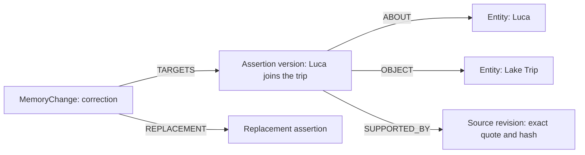

# Storage and data model

[Documentation index](README.md)

The **vault** is the local directory containing the memory's files. The **ledger** is one
file inside that directory; it is not another name for the whole vault.

## Vault layout

The default host location is `./vault`, mounted at `/data/vault` in the MCP container.
The host path can be configured.

```text
vault/
├── .memory/
│   ├── vault-id                              # stable namespace for this vault
│   ├── events.jsonl                          # append-only operation ledger
│   ├── source-versions/
│   │   └── <source-id>/<revision>-<hash>.md    # immutable source originals
│   ├── writer.lock                           # serialization of canonical writes
│   ├── extraction-locks/                     # per-revision foreground/worker locks
│   ├── views.lock                            # serialization of generated views
│   ├── views.json                            # generated-view checkpoint
│   └── recovery/                             # fragments of interrupted final appends
├── entities/<entity-id>.md                    # generated entity profiles
└── episodes/<source-id>.md                    # readable, editable source copies
```

## Originals and the ledger

An original source records **what was received**. Each revision has a source ID, revision
number, SHA-256 hash, title, scope, kind, observation time and recording time. Its exact
UTF-8 text is stored in an immutable Markdown snapshot.

The ledger records **what the engine did with that input**: saving a source, adopting an
extraction, registering claims, correcting or revising an assertion, making an identity
decision, or updating embeddings. Events also retain operation IDs and timestamps.

These two forms of data work together. A source alone does not say which claims were
adopted, while a ledger assertion refers to the original evidence supporting it. Replaying
the ledger reconstructs the memory state and its history without asking a language model
to interpret every original again.

Events are JSON Lines records linked through SHA-256 hashes. The store verifies hashes,
sequence numbers, operation uniqueness and chronological consistency while reading. A
complete, fsynced event is the commit point. The source is saved before its source event;
model calls and graph updates happen afterward.

Reading an original checks its SHA-256 hash. Returning evidence also checks that its exact
character slice still equals the recorded quote. An integrity failure is not silently
treated as a valid source.

## Markdown views

`entities/` contains generated profiles with an entity's ID, type, scope, identity history,
claims and source links. These profiles can be regenerated from the ledger.

`episodes/` contains readable copies of sources. The engine creates a missing copy but
does not overwrite an existing manual edit. Editing one of these copies does not
automatically import a revision or update Neo4j. The CLI `refresh` operation explicitly
registers edited episode text as a new immutable source revision and processes it.

A source can mention many people, events and claims. The model is instructed to use a
small number of broad entities rather than creating an entity or Markdown file for each
attribute.

## Entities, claims and evidence

An entity has a stable ID, name, kind and scope. A claim is an individual assertion about
an entity; it may also point to another entity.

| Claim field | Meaning |
| --- | --- |
| `subject_id` | Entity the assertion is about |
| `predicate` | Canonical relation or attribute key, when registered |
| `value` | Short readable value |
| `object_id` | Optional related entity |
| `statement` | Self-contained readable assertion |
| `scope` | Logical memory compartment, such as `personal`, `work` or `demo` |
| `context` | Specific topic or relationship context |
| `epistemic` | `explicit`, `proposed` or `inferred` |
| `polarity` | `positive` or `negative` |
| `valid_from`, `valid_to` | Interval in which the assertion applies |
| Recording/version timestamps | When that version entered or left the engine's knowledge |
| `evidence` | Source revision, exact quote and Unicode character offsets |
| `embedding`, `embedding_model` | Optional vector and the model used to produce it |
| `provenance` | Origin and available extraction, source, vocabulary and validation hashes |

`explicit` means that a source states something. It does not establish that the statement
is independently true. An explicit denial is `epistemic=explicit, polarity=negative`;
negation is not automatically an inference. Tentative plans must remain distinguishable
from decisions.

For example:

```text
Entities:
  Luca       → person
  Lake Trip  → trip

Claim:
  subject:    Luca
  predicate:  participation
  object:     Lake Trip
  context:    attendance
  epistemic:  explicit
  polarity:   positive
  quote:      "Luca is joining the Lake Trip."
```

The vocabulary maps `participation` to `urn:sbrain:vocab:participatesIn`. Unknown precise
types and predicates remain possible through stable extension IRIs; registered relation
signatures and reasoning rules are described in the [knowledge reference](knowledge.md).

## Why an assertion is a graph node

Neo4j stores `Entity`, `SourceRevision`, versioned `Assertion`, `MemoryChange`,
`IdentityChange` and `MemoryMeta` nodes. An assertion is an intermediate node so that
provenance, negation, validity and changes can attach to the statement itself.

```text
             ┌── ABOUT ────────→ Luca
Assertion ───┼── OBJECT ───────→ Lake Trip
             └── SUPPORTED_BY → Source, revision 1

Assertion properties:
participation, explicit, positive, context, dates, embedding, ...
```



Other projected relationships include `MERGED_INTO` for explicit identity decisions.
This representation can retain conflicting statements and show when and on what evidence
each was recorded. A contradictory new source does not silently erase an old assertion.

## Persistence and reconstruction

The vault is on the host filesystem, while Neo4j data and Ollama model files use persistent
Docker volumes. Stopping or recreating a container does not by itself erase these locations.
Deleting the host vault or removing the data volumes is a separate operation.

The ledger and originals allow Neo4j and generated profiles to be rebuilt through `replay`.
RDF exports are snapshots of a selected view, not an additional authoritative store.
SQLite recovery jobs live separately at `/data/jobs/queue.sqlite3` on the `jobs_data`
volume. They store work identifiers, statuses, retry/lease metadata and safe error codes,
not source text or embedding vectors. If that derived queue is lost, reconciliation can
rediscover unfinished work from the vault, but previous attempt counts and review decisions
are lost. Preserve the volume across ordinary restarts.
The [temporal memory page](temporal-memory-and-corrections.md) explains how historical
versions and explicit identity decisions affect those views.
