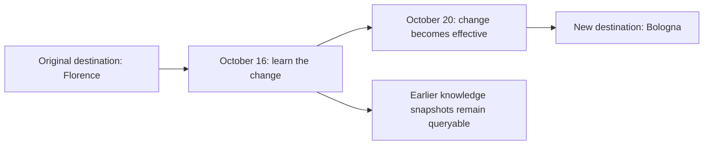

# Temporal memory and corrections

[Documentation index](README.md)

The engine distinguishes when a statement applies from when it became known. Both axes
are reconstructed from the append-only ledger without asking a model to interpret history.

## Two time axes

| Axis | Meaning | Query parameter |
| --- | --- | --- |
| Valid time | When the information applies to the described situation | `valid_at` |
| Knowledge time | When the engine knew a particular version of that information | `known_at` |

Sources also have `observed_at`, which supplies the default claim validity start when no
supported start was extracted. This is different from inventing a date from an event name
or assuming that a planned event's date is the date a decision was made.

All supplied timestamps must include a timezone and are normalized to UTC. Starts are
inclusive; ends are exclusive. Omitted retrieval times default to now.

## A real-world change

Suppose the memory initially says a trip's destination is Florence. On October 16, 2026,
the user records a real change: from October 20 at midnight in Rome, the destination will
be Bologna. The engine learns the change on the 16th, but it becomes effective on the 20th.

| View | Result |
| --- | --- |
| Updated knowledge; valid on October 19 | Florence |
| Updated knowledge; valid on October 21 | Bologna |
| Knowledge from before October 16; valid on October 21 | Florence |

The last query asks what the engine believed about the future before learning the change.
Historical knowledge can therefore differ from a later corrected understanding of the
same valid time.

## Explicit change operations

| Tool | Meaning | Effect |
| --- | --- | --- |
| `correct` | An earlier assertion was mistaken | Retract the erroneous claim in updated knowledge and register its replacement; by default retain the original validity interval |
| `revise` | The situation actually changed | Keep the preceding value valid until `effective_at`, then apply the replacement |
| `retract` | An assertion should no longer be adopted | Retract it while retaining its evidence and audit history |

A new `remember` call does not automatically perform any of these operations. Conflicting
claims can coexist until an explicit correction, revision or retraction is supplied.

Each change creates an immutable source recording the declaration and reason and appends
a change event. Existing ledger events and source originals are not overwritten. A
retraction is not a privacy purge: the original data remains stored.

The change path bypasses chat extraction. Replacement claims receive new embeddings when
available. Python checks enforce parameters, temporal consistency and the expected target
version; if another writer changes that version first, the operation is rejected and must
be reloaded rather than silently overwriting it.

`correct` and `revise` preserve the target claim's subject, predicate, context and scope.
They update the supplied value, statement, applicable dates and optional polarity.
Unchanged target values, approved aliases and polarity-only corrections retain object
identity. Legacy descriptive values such as participation `yes/no` also retain their
separate target. When the old value identifies its object by name and the replacement
no longer names that same object or an approved alias, the previous link is detached:
a new `Madrid` value must never keep pointing to the `Dublin` node. The replacement
records `object_link_change=detached_changed_value` and `previous_object_id` in provenance. Old versions retain their original links.

These operations do not accept a new object entity ID and do not guess a replacement
identity. The replacement remains a readable literal assertion, compatible with the
manual-change contract. Register an owner-attested structured assertion through the offline CLI
when a new explicit entity link is required. Existing ledger entries are not rewritten.

The extraction-and-SHACL pipeline applies to `remember` and `extract_source`. Explicit
change operations have their own Python validation path and do not run that extraction
pipeline. `validate_knowledge` remains available to audit the resulting snapshot.

## Identity history

An approved alias or merge is an explicit decision, recorded with a source, reason,
effective time and recording time. Similar names do not authorize an automatic merge.
Merges require the same scope and kind and preserve original entity and claim IDs.

`recall` resolves canonical identities using the requested valid and knowledge times.
An alias or merge learned later does not silently alter an earlier knowledge view.

## Temporal reasoning and exports

RDF itself does not provide this application's bitemporal query policy. The engine first
selects the requested view, then constructs RDF and any reasoning premises. Corrections,
retractions, identity decisions and changed query times affect subsequent computations.

OWL uses the currently installed vocabulary, identified by its hash. `known_at` reconstructs
historical memory knowledge; it does not replay historical versions of the ontology.
See [reasoning](reasoning.md) and the [knowledge reference](knowledge.md).
